# 🧪 Gestión de Laboratorios

Sistema web para administrar la operación y reservación de laboratorios académicos. Ofrece paneles y permisos diferenciados para **alumnos**, **profesores**, **laboratoristas** y **coordinación**.

    

---

## 📑 Contenido

- [Funciones principales](#-funciones-principales)
- [Stack tecnológico](#%EF%B8%8F-stack-tecnol%C3%B3gico)
- [Roles](#-roles)
- [Capturas de pantalla](#-capturas-de-pantalla)
- [Validación](#-validaci%C3%B3n)

---

## ✨ Funciones principales

|||
|---|---|
|📅|Creación, consulta y cancelación de reservaciones|
|📄|Carga de prácticas y generación de comprobantes en PDF|
|🔧|Seguimiento de préstamos e incidencias de laboratorio|
|👥|Administración de usuarios, laboratorios y reservaciones|
|📊|Estadísticas de uso por periodo y laboratorio|
|🔐|Autenticación por rol, reCAPTCHA y cambio de contraseña|
|📥|Importación de usuarios mediante CSV y soporte por correo|

---

## 🛠️ Stack tecnológico

|Área|Tecnologías|
|---|---|
|**Backend**|PHP 8.1+, Apache|
|**Base de datos**|MySQL / MariaDB|
|**Frontend**|HTML, CSS, JavaScript, Bootstrap 5, Chart.js|
|**Integraciones**|FPDF, Google reCAPTCHA v2, Brevo API|
|**Entorno**|Docker, Docker Compose|

---

## 👤 Roles

|Rol|Permisos|
|---|---|
|🎓 **Alumno**|Reserva laboratorios y consulta o cancela sus reservaciones|
|👨‍🏫 **Profesor**|Programa prácticas y da seguimiento a sus reservaciones|
|🧑‍🔬 **Laboratorista**|Supervisa préstamos y registra incidencias|
|🗂️ **Coordinación**|Administra usuarios, laboratorios, reservaciones y estadísticas|

---

## 📸 Capturas de pantalla

 
<strong>General</strong>
  

|Inicio|Cambio de contraseña|Ayuda|
|---|---|---|
|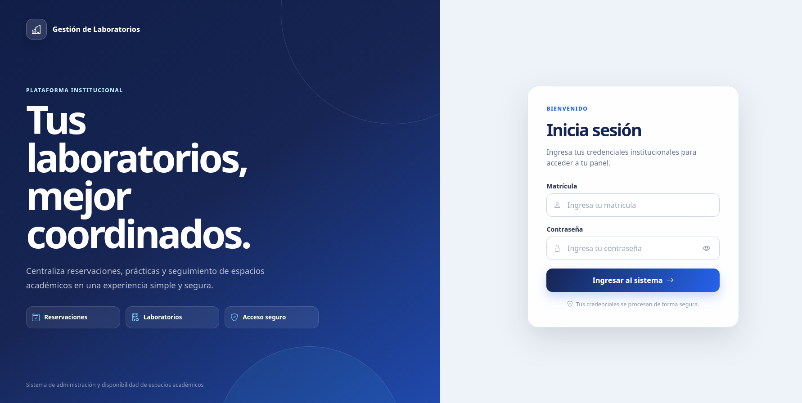||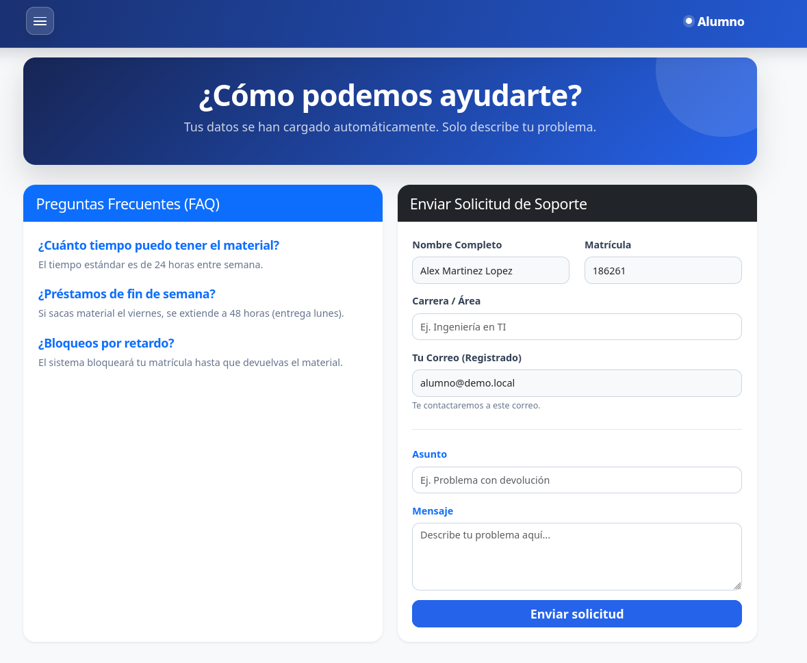|

 
 
<strong>Reservaciones</strong>
  

|Detalles de reserva|Cancelación de reservación|Historial de reservas|
|---|---|---|
|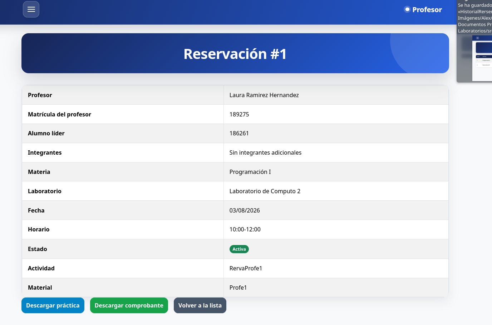|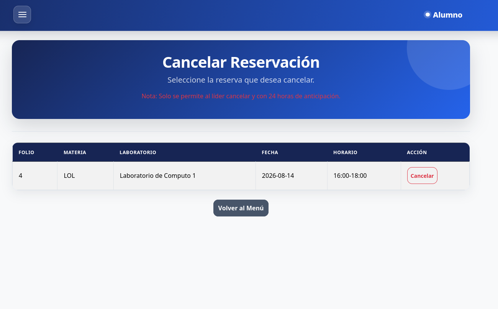|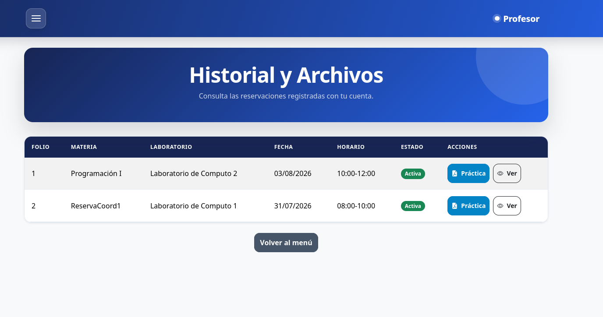|

 
 
<strong>Laboratorista</strong>
  

|Incidencias de laboratorio|
|---|
|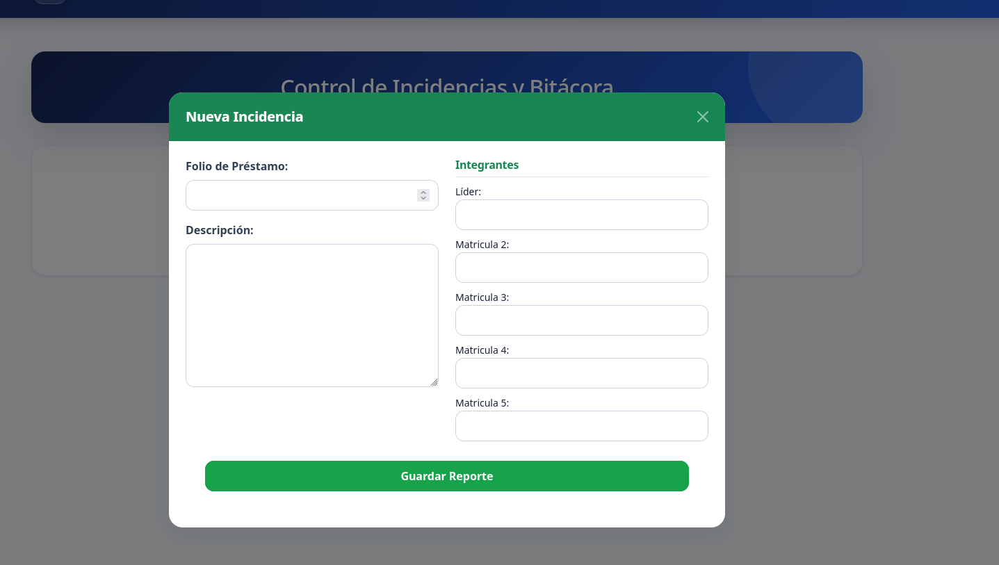|

 
 
<strong>Coordinación</strong>
  

|Estadísticas|Gestión de laboratorios|Gestión de reservaciones|Gestión de usuarios|Dashboard|
|---|---|---|---|---|
|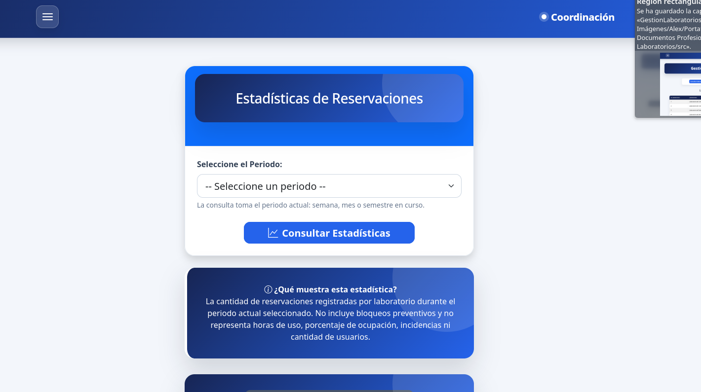|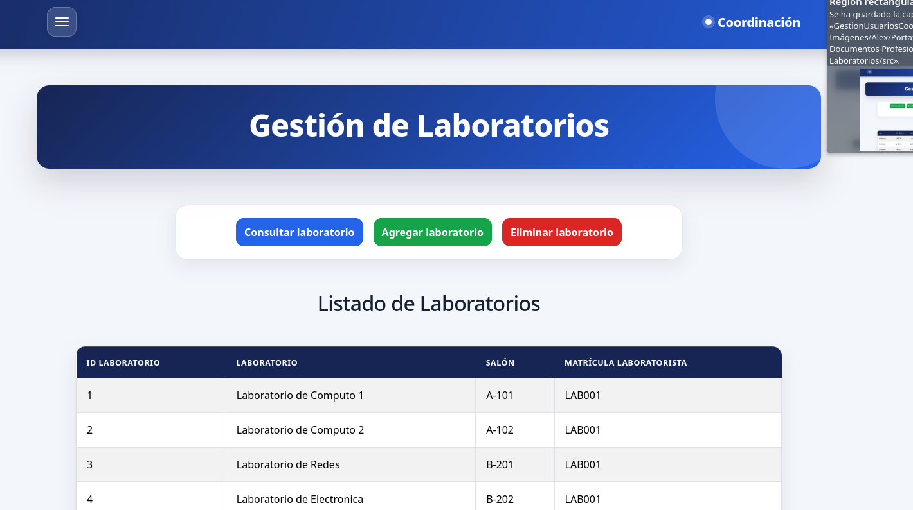|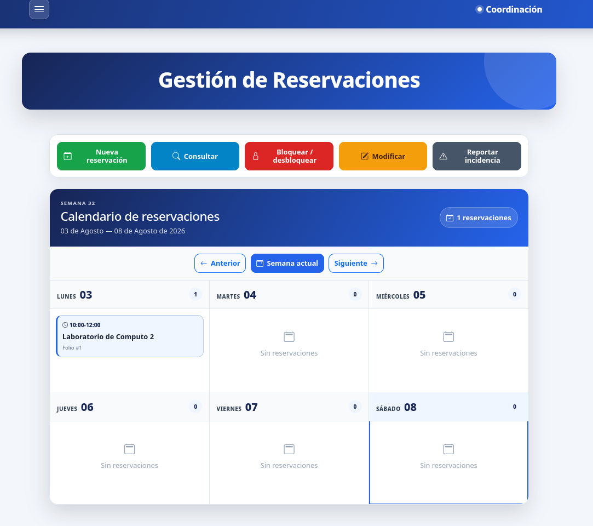|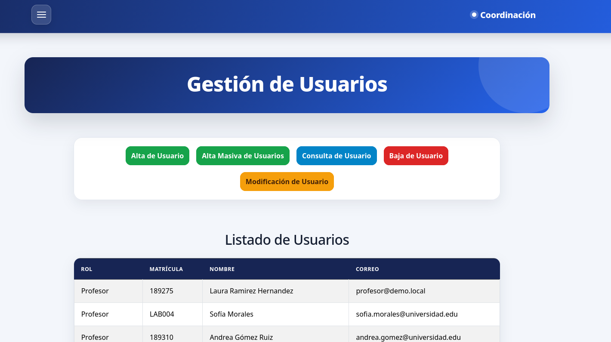|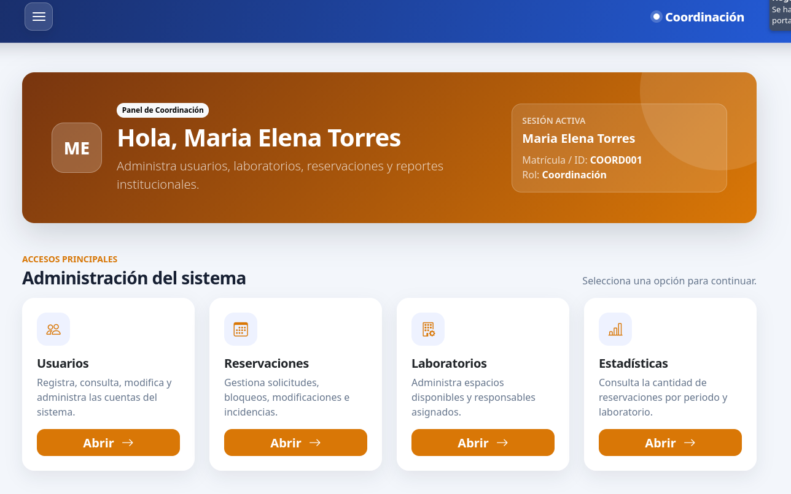|

---

Hecho con 🐘 PHP y ☕ por 
<a href="https://github.com/alextristanc">alextristanc</a> 
<a>Denzel Alain Pozos Vázquez</a> 
<a>Dominic Alberto Rivera Avila</a> 

